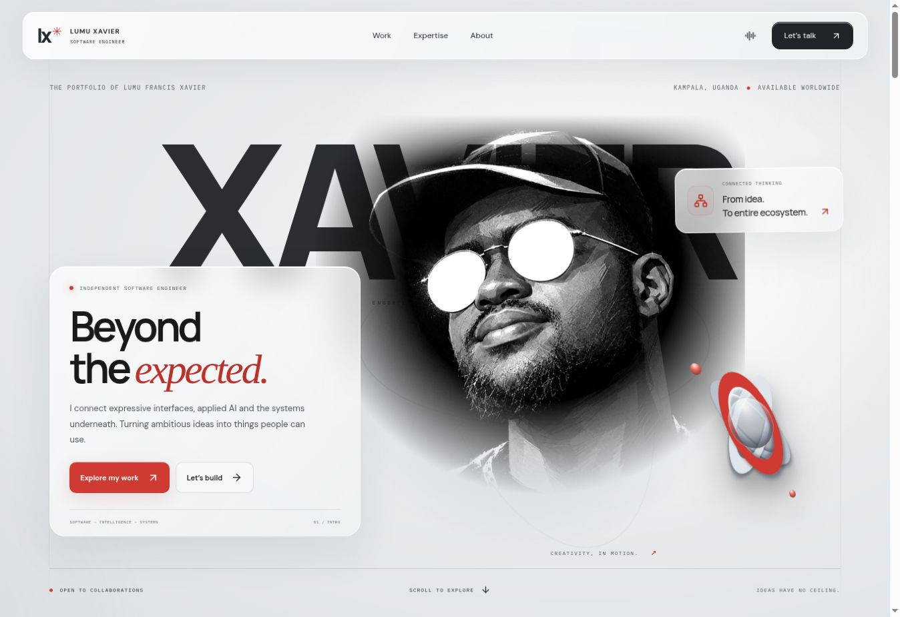

# Lumu Francis Xavier — Portfolio

A glass-and-motion React portfolio for Lumu Francis Xavier, a software engineer in Kampala, Uganda. The design brings together a floating portrait, a reflective 3D sculpture, layered glass cards, interactive capability stories, and responsive layouts.

The cinematic hero combines oversized background typography, the supplied portrait, frosted white glass, and precise vermilion highlights on a pearl-and-silver background. Scrolling reveals a bright silver perspective section with a glass scene explorer. Three.js sculptures connect the visual story to systems engineering, AI, and interfaces.

The site presents engineering capabilities across full-stack applications, systems, AI/ML, network infrastructure, data architecture, and mobile product experiences. Copy focuses on approach and outcomes, with no academic labels, invented credentials, unverified business metrics, or claim of shipped native mobile apps. Private client work, unfinished products, and confidential project details are not published.



## Local development

Use Node.js 22.12 or later. Deployment uses Node.js 24.

```sh
npm ci
npm run dev
```

## Production build

```sh
npm run build
```

The `dist/` folder contains the complete static website generated by Vite and the prerender step. It is committed for manual upload if needed. All fonts, icons, scripts, and portrait assets are local. The homepage includes its content before JavaScript runs.

Three.js loads separately when a scene approaches the viewport. The hero has a rotating chrome-and-glass sculpture; the perspective panel switches between an orbital system, connected intelligence nodes, and layered interface panels. Visitors can rotate the interactive scene with pointer movement or a horizontal drag while vertical touch scrolling stays available.

Rendering pauses outside the viewport and in hidden tabs. Mobile devices use simpler geometry, a lower pixel-density cap, and a 30fps rendering budget. Desktop visitors have a motion control that remembers their choice. Mobile and touch layouts start motion automatically without a Play/Pause button, independently of any saved desktop pause. Both layouts respect the system's reduced-motion preference. Browsers without WebGL2, or with a lost graphics context, display animated CSS versions of all three scenes.

The motion layer adds staggered headline and card entrances, cursor-responsive depth, scroll-linked portrait movement, travelling signal paths, glass highlights, and a reading progress line. Desktop uses a sticky cinematic hero; phones use a vertical composition that keeps the artwork, copy, and controls readable. Mobile layouts include automatic portrait sway, orbit drift, animated skill icons, and floating application illustrations. DOM scroll and pointer updates are batched into animation frames. Decorative CSS animation pauses outside the viewport and in hidden tabs.

## InfinityFree deployment

The `Deploy to InfinityFree` GitHub Actions workflow runs on every push to `main`:

1. Install dependencies.
2. Run the production build.
3. Verify the required FTP secrets.
4. Upload the generated `dist/` contents to the configured InfinityFree `htdocs` directory.

Required repository Actions secrets:

| Secret | Value |
| --- | --- |
| `FTP_SERVER` | Hosting account's FTP hostname |
| `FTP_USERNAME` | Hosting account's FTP username |
| `FTP_PASSWORD` | Hosting account's FTP password |
| `FTP_SERVER_DIR` | Verified website directory ending in `/htdocs/` |

Target domain: [lumuxavier.site.je](https://lumuxavier.site.je).

The workflow builds from source and uses certificate-verified FTPS. Missing secrets cause the upload step to be skipped; a successful build alone does not confirm deployment. Credentials belong in GitHub Actions secrets, never in source files.

For manual deployment, upload the **contents** of `dist/` into the domain's `htdocs` directory, preserving its subfolders. There is no Node.js server to run on InfinityFree.

## Content and privacy

Edit `src/profile.js` for public contact information, capability descriptions, and technology lists. Capability artwork is illustrative, not a screenshot or disclosure of a private product. No individual project repository or demo links are included. The portrait is the supplied original image; the lower-resolution legacy portrait remains available at its existing path.

Public contact links:

- GitHub: [lumuxav](https://github.com/lumuxav)
- WhatsApp: [0757 742 177](https://wa.me/256757742177)
- Instagram: [_l.u.m.u_](https://www.instagram.com/_l.u.m.u_/)

The contact form validates the visitor's name and message, then opens a WhatsApp draft. The visitor chooses whether to send. There is no form submission server or stored message database. The study year, student identifier, private project details, and unsupported credentials are omitted.

## Verification

The pearl, silver, black, and vermilion palette follows the supplied color reference. The hero, scene explorer, expertise cards, work artwork, contact section, and mobile navigation were visually reviewed. The 390px and 320px phone previews have no horizontal overflow and start motion automatically. Checked hero and skill text, red headings, primary buttons, and form placeholders exceed 4.5:1 contrast against their intended surfaces; this is a focused palette check, not a full accessibility audit. The Three.js materials, CSS scene fallback, SVG artwork, browser theme color, and favicon use the same palette.

The cinematic Three.js revision was checked on 2026-10-11 at desktop, 768px tablet, and 390px/320px phone widths. These layouts had no horizontal overflow. Checks covered the three discipline selectors and their descriptions, desktop pause/resume, mobile navigation, capability filtering, and dialog opening. Mobile starts motion automatically, including after reload with a saved desktop pause; transform samples confirmed that the fallback keeps moving without interaction.

The production build includes server rendering and asset generation. All three Three.js models were checked in desktop and compact configurations for valid finite geometry, exclusive variant visibility, disposal, and camera framing across multiple rotations. The available preview browser has WebGL disabled, so the CSS fallback was visually checked; actual GPU rendering still requires visual verification in a WebGL2-capable browser. The reduced-motion rules and rendering lifecycle are retained.

## Structure

```text
src/App.jsx             Sections, interactions, dialogs, and contact composer
src/profile.js          Public profile, build domains, skills, and links
src/CinematicExperience.jsx  Portrait hero and interactive perspective section
src/SpatialScene.jsx        Lazy scene mounting and CSS fallback
src/createSpatialScene.js   Three.js rendering, interaction, and lifecycle
src/spatialModels.js        Systems, intelligence, and interface geometry
src/cinema.css              Cinematic composition and responsive glass styling
src/styles.css          Glass surfaces, animation, and responsive layout
src/theme.css           Reference palette and section-specific colors
src/motion.css          Entrances, signal paths, depth, and hover effects
src/useSceneMotion.js   Scroll/pointer coordination and visibility lifecycle
src/main.jsx            React hydration and locally bundled fonts
src/render.jsx          Server render used during the build
scripts/prerender.mjs    Build-time HTML generation
.github/workflows/      Automatic InfinityFree deployment
public/                 Static assets and licenses
dist/                   Generated files ready for htdocs
```

Font and Three.js licenses are included under `public/licenses/` and copied into the upload folder. Lucide icons are provided under the ISC license.
